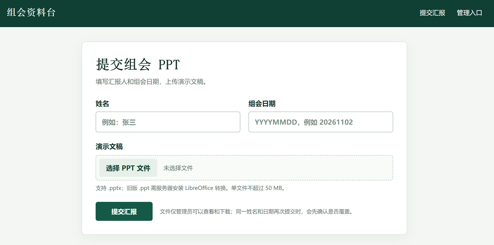
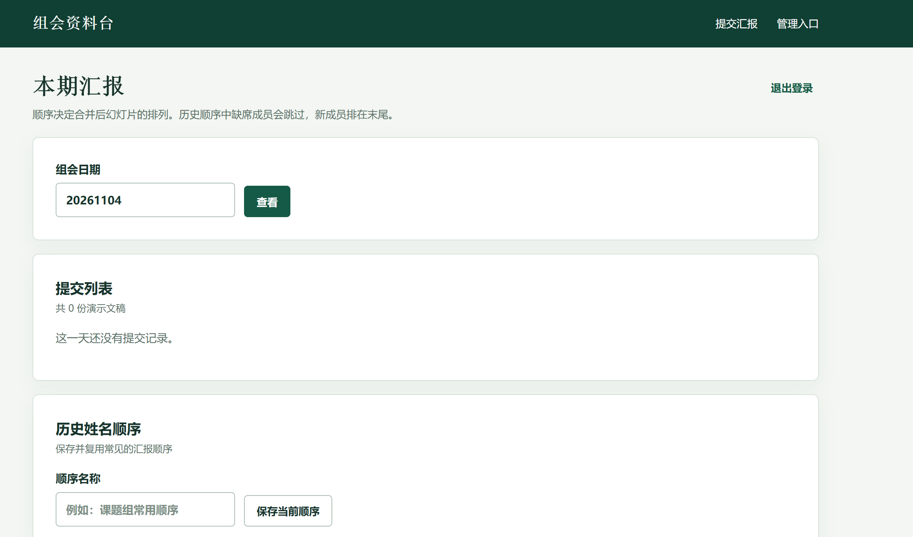

# 组会 PPT 资料台

本项目是可本地运行的中文组会汇报收集网页。公开页面 `/` 提交文件；管理员在 `/admin` 查看、排序、下载 ZIP、删除文件及合并 PPTX。默认只监听本机 `127.0.0.1:1410`。仓库没有预置密码或密钥，也没有部署到任何服务器。

## 界面预览

### 提交组会 PPT

填写姓名和组会日期，选择演示文稿后提交。



### 管理后台

按日期查看提交记录，并保存、复用历史姓名顺序。



## Windows 快速开始

在 PowerShell 中进入 `D:\group-meeting-ppt-hub`：

```powershell
$env:UV_CACHE_DIR='D:\group-meeting-ppt-hub\.uv-cache'
uv venv --python 3.12 .venv
uv pip install --python .venv\Scripts\python.exe -r requirements-dev.txt
.venv\Scripts\python.exe setup.py
.\start.ps1
```

`setup.py` 使用隐藏输入读取管理员密码（至少 12 字符），只在被 Git 忽略的 `config.json` 中写入密码哈希和随机会话密钥。不要把该文件发给别人。打开 `http://127.0.0.1:1410/`；管理员用户名默认是 `admin`。也可通过环境变量 `PPT_HUB_ADMIN_USER`、`PPT_HUB_ADMIN_PASSWORD_HASH`、`PPT_HUB_SECRET_KEY` 配置，不需要 `config.json`。

## Linux 快速开始

```bash
cd /path/to/group-meeting-ppt-hub
export UV_CACHE_DIR="$PWD/.uv-cache"
uv venv --python 3.12 .venv
uv pip install --python .venv/bin/python -r requirements-dev.txt
.venv/bin/python setup.py
.venv/bin/python app.py
```

可选安装 LibreOffice Impress，以接收旧版 `.ppt`。未安装时网页会明确提示先转成 `.pptx`。Windows 可将 `soffice` 加到 `PATH`；Linux 可安装发行版的 `libreoffice-impress`。转换失败不会写入提交记录。`.pptx` 无需 LibreOffice。

## 管理操作

在管理页输入八位公历日期。上下箭头调整合并顺序；ZIP 中也采用此顺序。可保存有名称的历史顺序，应用时跳过本日没有提交的人，并把新成员按当前顺序排在末尾。删除所选、删除整日及覆盖操作都会在浏览器内明确确认。合并下载名为 `YYYYMMDD.pptx`，不会替换原始上传文件。

## PPTX 保真范围

合并按引用关系复制 OOXML 部件，不截图、不重绘形状，也不复制其他文件中未被引用的部件。测试用 PPTX 验证了文本顺序、图片、原生图表、备注、布局/母版关系、两种主题 XML、关系目标完整性和页数。输出会再次由 `python-pptx` 打开并核对页数；失败时不交付文件。此检查不能替代 Microsoft PowerPoint 实际打开验证。

所有输入必须具有**完全相同的页面尺寸**；不同宽高或宽高比会报错，需先统一尺寸。合并文档采用第一份文件的演示级设置；其他文件的演示级节、放映设置、作者属性等不会合并。OOXML 每个演示文稿最多允许一个备注母版和一个讲义母版。默认情况下，备注母版不同会明确报错并提示管理员勾选“统一备注母版（保留备注内容，备注排版可能变化）”；该选项默认未勾选。勾选后合并会采用顺序中第一份可用的备注母版，将其他备注页关联到它，保留备注页内容及其图片、图表、媒体关系，但备注排版可能变化，不保证备注布局保真。讲义母版冲突始终明确报错，不能通过该选项跳过。外部链接保持为外部链接，但其目标可用性不受保证。宏和 ActiveX 被拒绝。SmartArt、OLE 对象、动画、字体替换及复杂嵌入对象未做视觉保真测试；复制关系链可保留其部件，但请在 PowerPoint/LibreOffice 中人工检查重要文件。旧版 `.ppt` 经 LibreOffice 转换的视觉差异取决于 LibreOffice。本服务不执行用户上传的脚本或宏。

单文件最多 50 MB；PPTX 最多 3000 个部件、解压总量 300 MB，单部件压缩比超过 1000 的文件会被拒绝。合并输出最多 500 MB，且仍须符合部件/解压限制。上传文件位于 `data/uploads/`，没有公开文件路由；元数据位于 `data/hub.sqlite3`。文件名由服务器生成，不使用上传者的路径。SQLite 写事务和原子替换用于并发覆盖；启动时恢复未完成的删除并清理临时/孤立文件。

## 测试

```powershell
.venv\Scripts\python.exe -m pytest -q
```

Linux 改为 `.venv/bin/python -m pytest -q`。测试包括 HTTP 上传/覆盖、非法输入、管理员认证/CSRF/限流、ZIP、删除、历史顺序、重启后的持久化，以及真实 PPTX 图片、图表、备注和主题合并。实际 RED/GREEN 记录见 [docs/testing.md](docs/testing.md)。

## 备份与恢复

停服务后复制整个 `data/` 目录，务必同时备份 SQLite 数据库和 `uploads/` 文件。恢复时停服务，将完整目录放回原路径，再启动。`config.json` 或 Docker 的 `.env` 也应单独安全备份；丢失会使旧登录会话失效，密码需重设。运行期间备份数据库应使用 SQLite 在线备份 API，不能只复制正在写入的单个数据库文件。

## Docker 与反向代理示例

Docker 镜像安装 LibreOffice Impress 以支持 `.ppt` 转换。先在**部署主机的项目目录**运行 `python setup.py --docker`（需安装 `werkzeug`），它以隐藏输入创建被忽略的 `.env`，其中只有密码哈希和随机密钥；`.env.example` 仅是占位符。然后：

```bash
docker compose up --build -d
```

Compose 要求密钥与哈希非空，持久化数据放在 `hub_data` volume，应用监听容器内 1410，宿主机仅绑定 `127.0.0.1:1410`。部署前请另行规划卷备份。Docker 当前环境若不可用，需在部署主机验证构建与运行。

下面是**供部署者参考**的 Nginx 配置，假设部署主机为 `10.200.64.79`，Nginx 对外监听 80，应用仍在本机 1410。此处没有连接或修改该服务器：

```nginx
server {
    listen 80;
    server_name 10.200.64.79;
    client_max_body_size 51m;
    location / {
        proxy_pass http://127.0.0.1:1410;
        proxy_set_header Host $host;
        proxy_set_header X-Forwarded-Proto $scheme;
    }
}
```

`/admin` 由同一个 `location /` 代理。公网或不可信网络应启用 HTTPS，再将 `PPT_HUB_HTTPS=1`，使会话 Cookie 标记 Secure；本地 HTTP 开发保持为 `0`。管理员登录按请求源 IP 限制 15 分钟内 5 次失败；若反向代理汇聚多个用户，应在代理层另外设置访问控制与限流。不要把 `data/`、`.env` 或 `config.json` 放进 Web 根目录。
